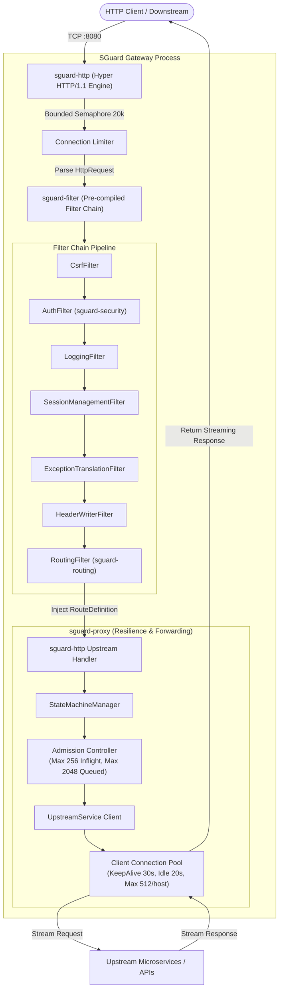
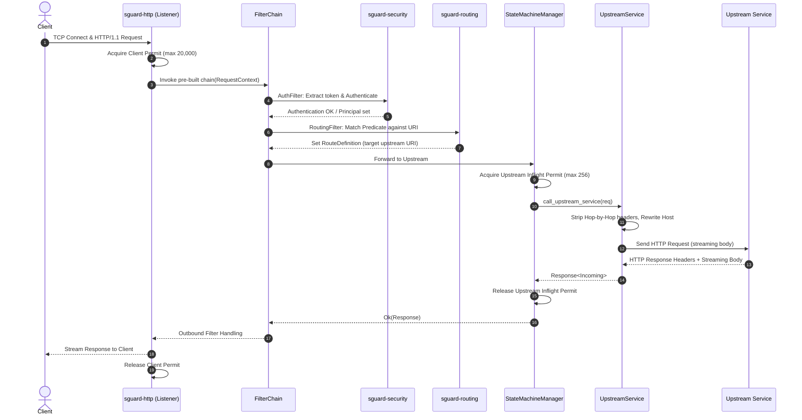
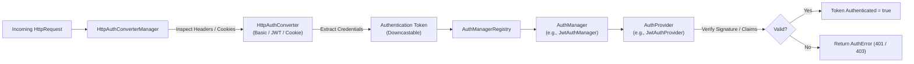

# SGuard Architecture Document

## 1. Executive Summary

**SGuard** is a high-performance, asynchronous edge API Gateway and reverse proxy implemented in **Rust**, powered by the **Tokio** asynchronous runtime and **Hyper (v1.x)**.

It provides centralized API routing, flexible security policy enforcement, protocol sanitization, upstream connection pooling, and resilient admission control for microservice architectures. SGuard blends design paradigms popularized by **Spring Cloud Gateway** and **Spring Security** (such as declarative routing filters and modular authentication chains) with the zero-cost abstractions, memory safety, and high-throughput guarantees of native Rust.

---

## 2. Design Principles & Goals

1. **High Concurrency & Low Latency**: Non-blocking I/O throughout the entire request path. Avoid unnecessary thread hops, mutex contention, and runtime dynamic allocations on the hot path.
2. **True Streaming (Zero Buffering)**: Request and response payloads are streamed asynchronously through `hyper::body::Incoming` and `UnsyncBoxBody` without buffering entire payloads into memory.
3. **Resilience by Design (Admission Control & Load Shedding)**: Prevent cascading failure under heavy traffic surges through explicit connection bounds, bounded waiting queues, connection timeouts, and fail-fast backpressure (HTTP 503).
4. **Separation of Concerns**: Modular workspace split across domain models, security, filter pipelines, routing predicates, upstream transport, and runtime server drivers.
5. **Pluggable Security**: Extensible authentication and authorization supporting Basic Auth, Bearer JWTs, Cookie-based sessions, and future enterprise federations (SAML/OAuth2/OIDC).

---

## 3. High-Level Architecture

The diagram below shows the high-level architecture of SGuard and the interaction between external clients, internal subsystems, and upstream services:



---

## 4. Workspace Decomposition (Crates)

The repository is organized as a Cargo multi-crate workspace:

```
sguard/
├── sguard               # Binary entry point and bootstrapping
├── sguard-core          # Common core traits, models, and body types
├── sguard-http          # HTTP listener, connection loop, and error mapping
├── sguard-filter        # Filter chain pipeline implementation and filters
├── sguard-security      # Authentication converters, managers, and providers
├── sguard-routing       # Route predicate resolvers and configuration loader
├── sguard-proxy         # Upstream forwarding, admission control, and pool
└── sguard-error         # Unified error typing and source classification
```

### 4.1. `sguard` (Gateway Binary)
- **Role**: Application entry point (`main.rs`).
- **Responsibilities**:
  - Initializes logging using `log4rs` (`log4rs.yaml`).
  - Instantiates `AppBuilder`.
  - Starts the asynchronous Tokio runtime and blocks on the gateway event loop.

### 4.2. `sguard-core` (Core Abstractions & Domain Models)
- **Role**: Shared contracts across all crates with zero circular dependencies.
- **Key Types**:
  - `HttpRequest`: Normalized internal representation wrapping `http::request::Parts` and optional streaming `hyper::body::Incoming`.
  - `HttpResponse`: Status, headers, and body abstractions.
  - `RequestContext`: Per-request state carrying `HttpRequest` and resolved `RouteDefinition`.
  - `ResponseBody`: Enum over `Full<Bytes>` (gateway-generated responses/errors) and `Incoming` (upstream-proxied streaming bodies), implementing `hyper::body::Body`.
  - `Filter`, `FilterFn`, `FilterRs`: Foundational traits and function pointer types defining the filter pipeline.

### 4.3. `sguard-http` (Network Driver & Lifecycle)
- **Role**: Downstream network acceptor and HTTP connection handling.
- **Key Features**:
  - **Connection Throttling**: Bounded via a `tokio::sync::Semaphore` (`MAX_CLIENT_CONNECTIONS = 20,000`) and a listener backlog (`LISTEN_BACKLOG = 4,096`) to prevent operating system file descriptor exhaustion.
  - **Hyper Server Driver**: Binds `hyper::server::conn::http1::Builder` with TCP `nodelay`, keep-alive, and header read timeouts (`10s`).
  - **Single Filter Chain Instantiation**: Assembles the entire filter chain wrapped around the upstream handler **once** during startup, eliminating per-request allocations.
  - **Error Translation**: Translates all gateway and upstream failures into compliant HTTP responses (`error_response`), ensuring connections terminate cleanly.

### 4.4. `sguard-filter` (Filter Pipeline Engine)
- **Role**: Interceptor framework modeled after the Chain of Responsibility / Onion architecture.
- **Key Components**:
  - `FilterChain`: Pre-compiles filters in reverse order at startup into a single composable `FilterFn`.
  - Built-in Filters:
    - `CsrfFilter`: CSRF validation hook.
    - `AuthFilter`: Dispatches credential extraction and verification to `sguard-security`.
    - `LoggingFilter`: Structured diagnostics and latency observation.
    - `SessionManagementFilter`: Downstream session tracking.
    - `ExceptionTranslationFilter`: Intercepts security and conversion failures.
    - `HeaderWriterFilter`: Injects edge security headers.
    - `BaseRoutingFilter`: Evaluates route matching rules.

### 4.5. `sguard-security` (Pluggable Authentication Framework)
- **Role**: Extensible security system inspired by Spring Security.
- **Pipeline Components**:
  - **Converters** (`HttpAuthConverter`): Extracts credentials from headers or cookies into typed tokens (e.g., `BasicHttpAuthConverter`, `JwtHttpAuthConverter`, `CookieHttpAuthConverter`).
  - **Tokens** (`Authentication` trait): Type-erased token carrying authentication status and `Principal`, leveraging `downcast-rs`.
  - **Managers** (`AuthManagerRegistry`, `AuthManager`): Selects the manager based on token variant (`BasicAuthManager`, `JwtAuthManager`, `CookieAuthManager`).
  - **Providers** (`AuthProvider`): Performs credential verification, cryptographic JWT decoding, or session lookups (`BasicAuthProvider`, `JwtAuthProvider`, `CookieAuthProvider`, `OpenSaml5AuthProvider`).

### 4.6. `sguard-routing` (Declarative Route Engine)
- **Role**: Ingests route definitions and resolves predicates for incoming requests.
- **Key Features**:
  - Ingests `routes.yaml` at gateway initialization.
  - `RouteResolverFactory` supports predicate strategies:
    - `Path`: Glob and exact path matching (e.g. `Path=/billing/api/**`).
    - `Host`: Host header matching.
    - `Query`: Query parameter inspection.
    - `Cookie`: Cookie presence or matching.
    - `Regex`: Full regular expression matching.
  - Enriches `RequestContext` with the matched `RouteDefinition` (upstream target URI, route ID).

### 4.7. `sguard-proxy` (Resilience & Upstream Forwarding)
- **Role**: Upstream HTTP client, connection pooling, and admission control.
- **Key Components**:
  - `StateMachineManager`: Upstream admission controller. Bounded semaphore (`MAX_INFLIGHT_UPSTREAM = 256`) and queue cap (`MAX_QUEUED = 2048`) with `QUEUE_TIMEOUT = 2s`. Excess load is immediately rejected with HTTP 503 (`Upstream overloaded`).
  - `UpstreamService`: Shared `hyper_util::client::legacy::Client` with tuned connection pooling (`POOL_MAX_IDLE_PER_HOST = 512`, `POOL_IDLE_TIMEOUT = 20s`).
  - **Streaming Body Forwarding**: Forwards incoming client bodies directly as `UnsyncBoxBody` to upstream without buffering.
  - **Idempotent Retry**: Safely retries bodyless idempotent requests (`GET`, `HEAD`, `OPTIONS`) on `StaleConnection` failures.
  - **Hop-by-Hop Stripping**: Cleans standard and custom hop-by-hop headers (RFC 7230) before dispatching to upstream.
  - **Diagnostics & Telemetry**: Categorizes upstream errors into `FailureKind` and logs periodic rolling health summaries.

### 4.8. `sguard-error` (Unified Error Subsystem)
- **Role**: Uniform domain error reporting across the application.
- **Types**:
  - `Error`: Contains `ErrorType` and `ErrorSource` (`Upstream`, `Downstream`, `Internal`).
  - `ErrorType`: Classifies I/O, timeouts, connection drops, protocol errors, and custom statuses.

---

## 5. End-to-End Request Lifecycle



---

## 6. Resilience, Concurrency & Tuning Reference

SGuard incorporates defensive mechanisms against socket exhaustion, thread starvation, and upstream brownouts:

| Parameter | Location | Value | Purpose |
| :--- | :--- | :--- | :--- |
| `MAX_CLIENT_CONNECTIONS` | `sguard-http/src/app.rs` | `20,000` | Bounded semaphore for downstream client connections to protect system file descriptors (`ulimit -n`). |
| `LISTEN_BACKLOG` | `sguard-http/src/app.rs` | `4,096` | TCP accept backlog for kernel connection buffering with `SO_REUSEPORT` support. |
| `ROUTE_INFLIGHT_UPSTREAM` | `sguard-proxy/src/state_machine.rs` | `1,024` | Maximum concurrent upstream requests per isolated route bulkhead in the connect/header-wait phase. |
| `MAX_QUEUED` | `sguard-proxy/src/state_machine.rs` | `4,096` | Maximum requests permitted to wait for an upstream execution slot per route before shedding load. |
| `QUEUE_TIMEOUT` | `sguard-proxy/src/state_machine.rs` | `2s` | Timeout before a queued request fails fast with HTTP 503. |
| `POOL_MAX_IDLE_PER_HOST`| `sguard-proxy/src/upstream.rs` | `512` | Upstream keep-alive connection pool capacity per host. |
| `POOL_IDLE_TIMEOUT` | `sguard-proxy/src/upstream.rs` | `20s` | Eviction deadline for idle connections (kept strictly lower than upstream defaults like Nginx 75s). |
| `CONNECT_TIMEOUT` | `sguard-proxy/src/upstream.rs` | `3s` | TCP connect deadline for upstream sockets. |
| `RESPONSE_TIMEOUT` | `sguard-proxy/src/upstream.rs` | `30s` | Upstream response header deadline before HTTP 504 Gateway Timeout. |

---

## 7. Security Architecture Deep Dive

The authentication model in `sguard-security` follows a multi-stage flow:



1. **Extraction**: `HttpAuthConverterManager` inspects headers (`Authorization: Bearer ...`, `Authorization: Basic ...`) or session cookies (`Cookie: session=...`) and selects the appropriate converter.
2. **Token Generation**: An unauthenticated `Authentication` token is created.
3. **Dispatch**: `AuthManagerRegistry` routes the token to the registered `AuthManager`.
4. **Verification**: An `AuthProvider` decodes and validates credentials (e.g. verifying JWT signature with HMAC-SHA256 / RSA, or validating session cookies).
5. **Context Propagation**: Upon success, the principal is marked authenticated; upon failure, the filter pipeline short-circuits to an error response.

---

## 8. Configuration Specification

SGuard routes are defined declaratively in `routes.yaml`:

```yaml
routes:
  - id: user-service
    uri: http://user-service:5000
    predicates:
      - Path=/user/api/**
      
  - id: billing-service
    uri: http://billing-service:5000
    predicates:
      - Host=billing.internal.local
      - Path=/billing/api/**

  - id: health-check
    uri: http://localhost:9000
    predicates:
      - Path=/health
```

### Route Predicates:
- `Path=<pattern>`: URL path pattern (supports wildcards `/**`).
- `Host=<host>`: Matches downstream `Host` header.
- `Query=<param>`: Matches URL query parameters.
- `Cookie=<cookie_name>`: Matches incoming cookies.
- `Regex=<regex>`: Evaluates regular expressions against incoming URIs.

---

## 9. Failure Classification & Health Reporting

When upstream calls fail, `sguard-proxy/src/upstream.rs` traverses the error cause chain (`classify`) into distinct failure buckets:
- `ConnectRefused`: Upstream service down or port closed.
- `ConnectTimeout`: SYN dropped, firewall drop, or upstream accept queue full.
- `ConnectFailed`: Generic network/socket failure.
- `ResourceExhausted`: Local gateway out of file descriptors or ephemeral ports (`EMFILE`, `EADDRNOTAVAIL`).
- `StaleConnection`: Remote closed pooled socket before gateway reuse.
- `ResponseTimeout`: Upstream connection established but response exceeded deadline.

A background reporter task (`spawn_reporter`) logs aggregated failure snapshots every 10 seconds only when errors occur, avoiding logging storms during high-load traffic incidents.

---

## 10. Future Architectural Roadmap

1. **HTTP/2 & HTTP/3 (QUIC) Ingestion**: Upgrade downstream listener and upstream client to support end-to-end HTTP/2 and HTTP/3 multiplexing.
2. **Dynamic Route Reloading**: Integrate file-watch or etcd/Consul notifications to reload routes at runtime without gateway restarts.
3. **Distributed Rate Limiting**: Token-bucket and sliding-window rate limiting backed by Redis or internal memory tables.
4. **Active Circuit Breaking**: Transition from admission shedding to full circuit breaker state machines (Closed, Open, Half-Open).
5. **Telemetry & OpenTelemetry Tracing**: Native W3C `traceparent` propagation and Prometheus metrics exposition (`/metrics`).
